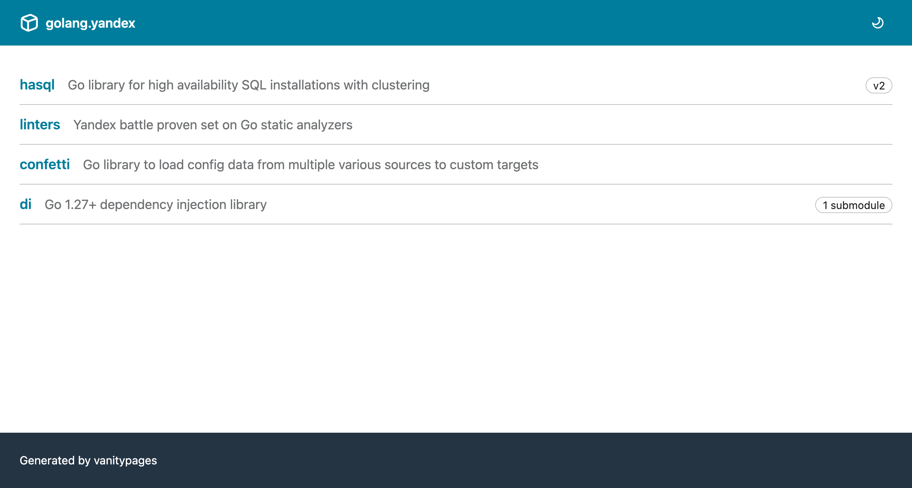
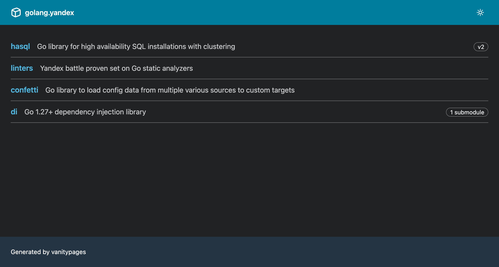
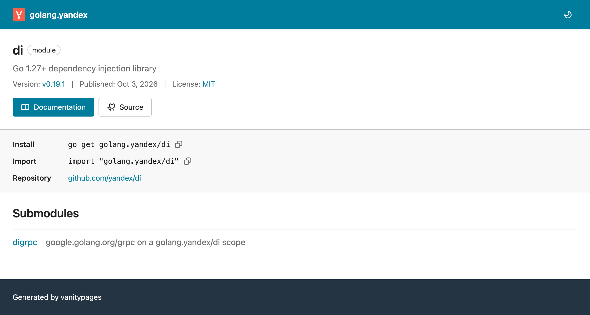
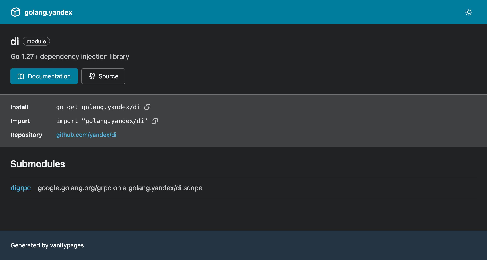
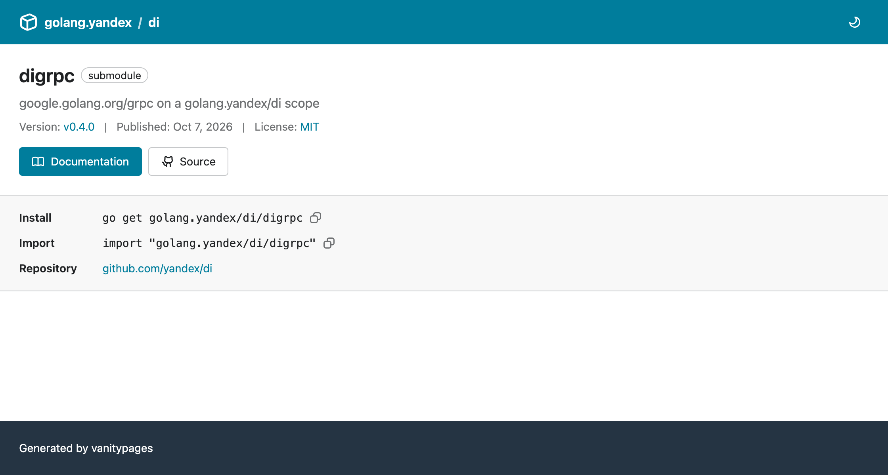
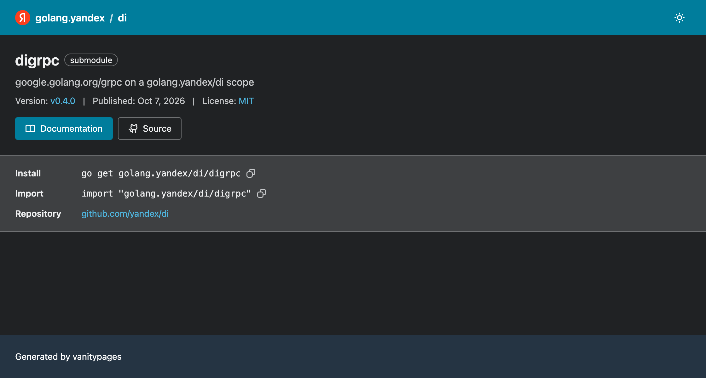
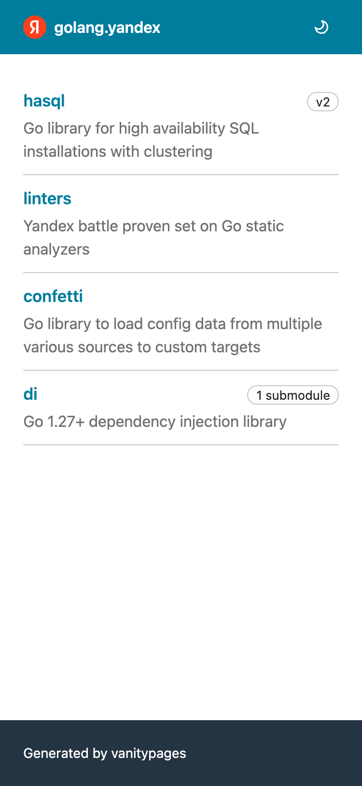
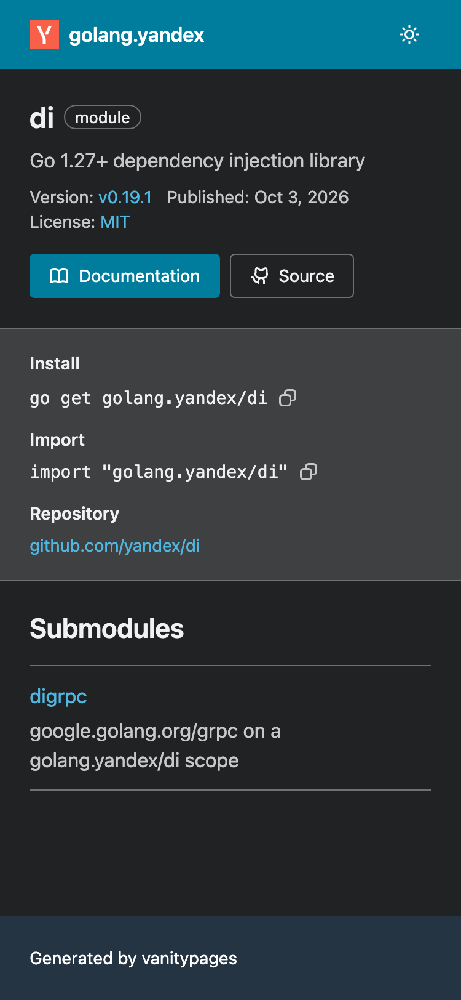

# vanitypages

[](https://github.com/floatdrop/vanitypages/actions/workflows/test.yml)

Generates a static site of Go vanity import pages, built with
[Gravity UI](https://gravity-ui.com) and styled after go.dev. Host the output
anywhere that serves static files, and `go get your.domain/module` resolves to
your repository.

## Gallery

|               | Light                                                                     | Dark                                                                     |
| ------------- | ------------------------------------------------------------------------- | ------------------------------------------------------------------------ |
| **Index**     |            |          |
| **Module**    |     |        |
| **Submodule** |                    |  |
| **Phone**     |  |  |

## Usage

```sh
go install github.com/floatdrop/vanitypages/cmd/vanitypages@latest
```

Create `vanitypages.json`. The `$schema` line gives you completion and
validation in editors:

```json
{
  "$schema": "https://raw.githubusercontent.com/floatdrop/vanitypages/main/vanitypages.schema.json",
  "domain": "go.example.com",
  "modules": [
    {
      "path": "cache",
      "repo": "https://github.com/acme/cache",
      "description": "Typed in-memory cache",
      "submodules": [
        { "path": "contrib/redis", "description": "Redis backend" }
      ]
    }
  ]
}
```

Run `vanitypages` to write the site to `public/`.

| Flag       | Default            | Description                                 |
| ---------- | ------------------ | ------------------------------------------- |
| `-config`  | `vanitypages.json` | Path to the config file                     |
| `-out`     | `public`           | Directory to write the site to              |
| `-details` |                    | Add published details from the docs site    |
| `-schema`  |                    | Print the config JSON Schema and exit       |
| `-version` |                    | Print the version and exit                  |

Generating overwrites earlier output but never deletes files, so clean the
output directory if you remove a module from the config.

With `-details`, pages show the latest version, publish date and license from
the API of the documentation site, and its synopses fill in missing
descriptions. If the site can't be reached, the build prints a warning and the
pages go without them. Rebuild regularly to keep the details current.

## Configuration

| Field         | Description                                                                 |
| ------------- | --------------------------------------------------------------------------- |
| `domain`      | Host the site is served from, optionally with a path. Required.             |
| `title`       | Index page heading. Defaults to `domain`.                                   |
| `description` | Text at the top of the index page.                                          |
| `icon`        | Header and favicon image file (SVG, PNG, ICO or WebP), relative to config.  |
| `docs`        | Base URL of the documentation site. Defaults to `https://pkg.go.dev`.       |
| `modules`     | The modules to serve. Required.                                             |

Each module has:

| Field         | Description                                                                 |
| ------------- | --------------------------------------------------------------------------- |
| `path`        | Module path relative to the domain. Required.                               |
| `repo`        | Repository URL. Required.                                                   |
| `vcs`         | `git` (default), `hg`, `svn`, `bzr`, `fossil` or `mod`.                     |
| `description` | Text shown on the index and module pages.                                   |
| `versions`    | Major versions above v1 developed at the repository root, such as `["v2"]`. |
| `submodules`  | Go modules nested in the repository, each with `path` and `description`.    |
| `packages`    | Package paths that should get a page of their own.                          |
| `source`      | `home`, `dir` and `file` URL templates for source links.                    |
| `hidden`      | Keep the module off the index page while it stays importable.               |

Source links are detected for repositories on github.com, gitlab.com,
bitbucket.org and codeberg.org. Use `source` for other hosts.

### Which paths need an entry

Static hosting can't match path prefixes, so every **module root** needs a page.
Packages inside a module don't: the go command retries shorter paths until it
reaches the module.

- A module whose `go.mod` at the repository root says `example.com/foo/v2`:
  add `"versions": ["v2"]`.
- A module with its own `go.mod` in a subdirectory, tagged `contrib/redis/v1.2.3`
  or kept in a `v2/` directory: add it to `submodules`. Its `path` must match the
  directory.
- A package you want a browsable page for: add it to `packages`. In a module
  with `versions`, the page is for the newest major version, such as
  `example.com/foo/v2/pkg`.

## Go API

```go
site := vanitypages.Config{
	Domain: "go.example.com",
	Modules: []vanitypages.Module{{
		Path:       "cache",
		Repo:       "https://github.com/acme/cache",
		Submodules: []vanitypages.Submodule{{Path: "contrib/redis"}},
	}},
}
if err := site.Generate("public"); err != nil {
	log.Fatal(err)
}
```

`Config.Render` returns the files in memory instead, and `vanitypages.Load`
reads a JSON config file. Assign the result of `Config.FetchDetails` to
`Config.Details` to get what `-details` adds.

## Deployment

To host a site on GitHub Pages:

1. Put your `vanitypages.json` in a repository and add
   `.github/workflows/pages.yml`:

   ```yaml
   name: Pages

   on:
     push:
       branches: [main]
     schedule:
       - cron: "23 4 * * *"
     workflow_dispatch:

   permissions:
     contents: read
     pages: write
     id-token: write

   concurrency:
     group: pages
     cancel-in-progress: true

   jobs:
     deploy:
       runs-on: ubuntu-latest
       environment:
         name: github-pages
         url: ${{ steps.deployment.outputs.page_url }}
       steps:
         - uses: actions/checkout@v7
         - uses: actions/setup-go@v7
           with:
             go-version: stable
             cache: false
         - run: go run github.com/floatdrop/vanitypages/cmd/vanitypages@latest -details
         - uses: actions/upload-pages-artifact@v5
           with:
             path: public
         - id: deployment
           uses: actions/deploy-pages@v5
   ```

2. In **Settings > Pages**, set **Source** to **GitHub Actions** and enter your
   domain under **Custom domain**.
3. Point DNS at GitHub Pages. For a subdomain, add a `CNAME` record for
   `<owner>.github.io`. For an apex domain, add `A` records for
   `185.199.108.153` through `185.199.111.153` and `AAAA` records for
   `2606:50c0:8000::153` through `2606:50c0:8003::153`, replacing any others.
4. When GitHub has issued the certificate, turn on **Enforce HTTPS**. The go
   command only fetches over HTTPS.
5. Check the site directly, bypassing the module proxy:

   ```sh
   GOPROXY=direct go list -m -versions your.domain/module
   ```

The daily schedule keeps `-details` current with new releases. GitHub pauses
scheduled workflows after 60 days without repository activity.

Any other static host works too: run `vanitypages` and upload `public/`. The host
has to serve `index.html` for directory URLs.

## Third-party assets

Generated sites include Gravity UI styles and icons (MIT), with licenses at
`/-/THIRD_PARTY_LICENSES.txt`. To update them, change the versions in
`internal/assets/vendor.sh` and run it.

## License

[MIT](LICENSE)
